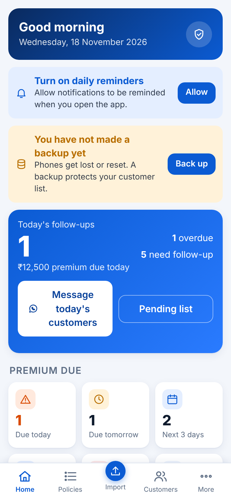

# LIC Smart Follow-up

An **offline-first premium-due follow-up app for LIC insurance advisors**. Import the premium due list PDF you receive, check the extracted table, and the app tells you every morning who to call: due today, in 3 days, in 7 days, overdue. It writes the WhatsApp reminder (English or Tamil) for you to review and send.

- **Private by design.** No login, no server, no analytics. Customer data lives only in the app's database on each advisor's own phone. The Android build does not even request the INTERNET permission.
- **Free to run.** No paid API, database or hosting. Runs on GitHub Pages (free) and as a sideloaded APK.
- **Works offline.** After the first load, everything works with no connection.

> Honest status: the web app, PDF parsing, due-date engine, messages, backup/encryption and notification *scheduling logic* are covered by automated tests (see [Testing](#testing)). The **Android APK build, real Android notifications, and in-browser OCR could not be run in the environment where this was written** and need a quick check on a real phone, listed in [Verify on a real phone](#verify-on-a-real-phone-before-you-distribute).



## Features

| Area | What it does |
|---|---|
| **PDF import** | Many PDFs at once (Downloads, Drive, email attachments via the Android file picker). Reads text PDFs with PDF.js, layout-tolerant: finds the header row (even two lines tall, repeated per page), maps columns by synonym (`Policy No`, `FUP`, `Premium Due Date`, `Instalment Premium`...), ignores the *Date of Commencement* column, joins wrapped names. PDFs without a table are read line by line. Password-protected PDFs prompt for the password. |
| **Verification screen** | Editable table of everything extracted, with counts (found / ready / needs review / failed / duplicates / missing info), the raw text of each row, and a PDF page preview. Invalid dates (e.g. 31-02-2026) and uncertain rows are **never auto-fixed or silently saved**. |
| **OCR (optional)** | Scanned PDFs are detected (no text layer). OCR via Tesseract.js, fully offline once vendored. Every OCR row is forced into manual review. |
| **Due tracker** | Today, Tomorrow, 3 / 7 / 15 days, This month, Overdue, Pending follow-ups, Follow-up completed, Payment confirmed. Calculated from the device date. A policy is **never** marked paid unless the advisor confirms the payment. |
| **Customers** | Search by name, policy number or mobile; sort by premium or date; multiple policies per customer; per-policy installment history; add/edit/delete; duplicate protection (policy number + due date, so next year's installment is allowed). |
| **Follow-up tracker** | Log calls / WhatsApp / visits with notes, statuses (Pending, Contacted, Promised, Completed). A customer contacted today leaves today's pending list and returns tomorrow if still unpaid. Daily performance chart. |
| **Messages** | Six templates (Today, Tomorrow, 3 days, 7 days, Overdue, General) in **English and Tamil**; editable; Copy, WhatsApp (`wa.me`, opens with the text ready), Android Share. Signed with your name only if you create a profile. **Never sends anything automatically.** |
| **Notifications** | Daily morning summary (default 08:00), optional evening summary, optional per-policy reminders, option to hide customer details on the lock screen. |
| **Calendar** | Monthly due calendar with per-day counts and a monthly collection summary. |
| **Backup** | JSON backup/restore (optionally including the original PDFs), **optional AES-256-GCM password encryption**, CSV export/import, customer CSV, printable HTML report, backup reminders, storage meter. |
| **Other** | Dark mode, installable PWA, Android back-button handling, optional profile (name, agent code, DO, branch, mobile, email). |

## Quick start (web)

```bash
npm install            # dev tools only; the app itself has no runtime dependencies
npm run vendor:ocr     # optional: copy Tesseract.js into public/vendor/ for scanned-PDF OCR
npm start              # http://localhost:8080
```

There is no build step: `public/` *is* the app (plain ES modules, hand-written CSS). PDF.js is vendored in `public/vendor/pdfjs/` so it works offline.

> **Stack note.** You listed React and Tailwind as preferred. This project deliberately uses plain JavaScript modules and hand-written CSS instead: zero build tooling means nothing to break on GitHub Pages or in the APK, a smaller download, and every file is readable. The architecture is framework-agnostic if you later want to port the UI.

## Publish on GitHub Pages (free)

1. Create a GitHub repository and push this folder (see [Uploading](#uploading-to-github)).
2. Repository **Settings → Pages → Source: GitHub Actions**.
3. Push to `main`. `.github/workflows/pages.yml` runs the privacy check, unit tests and browser tests, then publishes `public/`.
4. Your app is at `https://<your-username>.github.io/<repo-name>/`. Open it on a phone and use **Install app / Add to Home screen**.

All asset paths are relative, so the sub-path URL works (the browser tests run under a `/lic-smart-followup/` sub-path to prove it).

## Why a simple WebView wrapper or AppGeyser is not enough

You asked me to evaluate this. Wrapping the Pages URL (AppGeyser, "website to APK" tools) gives you a browser in a frame. For this app that fails the core requirements:

- **No reliable closed-app notifications.** A web page cannot run or schedule alarms when Android closes it. Wrappers have no bridge to Android's alarm system. (Capacitor's Local Notifications plugin does.)
- **Needs internet to open** unless the wrapper caches perfectly; the data-clearing behaviour of generic wrappers is unpredictable.
- **Downloads and sharing break.** WebViews cannot download `blob:` files; backups, CSV and PDF export need a native file/share bridge.
- Your agents' customer data would sit inside a third-party wrapper service's build, which is a privacy risk for exactly the data you want to protect.

So this project uses **Capacitor**: the same web app is bundled *inside* the APK (works with no internet and no hosting), plus native plugins for notifications, files, sharing and opening WhatsApp/the dialler.

## Build the Android APK

### Option A: let GitHub build it (no Android Studio needed)
Push the repo, open **Actions → "Build Android APK" → Run workflow**, then download the artifact `lic-smart-followup-debug-apk`.

### Option B: build on your computer
Requirements: Node 20+, JDK 17, Android SDK (Android Studio installs it).

```bash
npm install
npm run vendor:ocr        # optional but recommended
npm run android:add       # generates android/, applies permissions, syncs the web files
npm run android:apk       # -> android/app/build/outputs/apk/debug/app-debug.apk
# or: npm run android:open  (opens Android Studio)
```
After any change to `public/`, run `npm run android:sync` before rebuilding.

### What the Android build adds
- **Permissions** (applied by `scripts/patch-android.mjs`): `POST_NOTIFICATIONS` (Android 13+, asked at runtime from the Home screen banner or More → Notifications), `SCHEDULE_EXACT_ALARM` (exact-minute alerts; Android 12+ shows an "Allow exact alarms" shortcut), `RECEIVE_BOOT_COMPLETED` (re-arm reminders after reboot), `VIBRATE`, `WAKE_LOCK`. **No INTERNET permission.** `allowBackup` is off so customer data does not go into Google auto-backup (use the app's own backup instead).
- **File picker:** the PDF/CSV/backup buttons use the Android system picker (Downloads, Drive, Gmail attachments).
- **Share/export:** files are written to the app cache and handed to the Android share sheet ("Save to Drive", Files, WhatsApp, email).
- **Back button:** closes the open sheet, then navigates back, then exits.

### Distributing to your agents
1. Send the APK (WhatsApp, Drive, email).
2. On each phone: open the file, allow **"Install unknown apps"** for that app when asked, and accept the Play Protect "unrecognised app" prompt (it appears for any APK not from the Play Store).
3. Open the app → **More → Notifications → Allow**; set the battery option below.
4. Debug APKs are signed with a debug key. For a long-lived distribution create a release keystore and sign (`./gradlew assembleRelease`); **keep the same keystore forever**, because Android only installs updates signed with the same key.

Each phone has its **own independent database**; there is no shared account or server, so one advisor can never see another's customers.

## Notifications: how they really work

**Android app (Capacitor).** Android cannot run app code while the app is closed. So the app hands Android the **next 30 days of dated notifications** (`allowWhileIdle`), each with that day's counts pre-calculated. They fire with the app closed and with no internet. The schedule is rebuilt whenever the app opens, data changes, or settings change. So:

- Open the app at least once a month (and after importing new PDFs) to keep it current. If the phone goes 30 days untouched, reminders simply stop.
- Counts in a future-dated notification come from the data as of the last app open. Payments confirmed later in the app update the schedule immediately.
- Phone makers (Xiaomi/MIUI, Oppo/ColorOS, Vivo, Realme, some Samsung modes) aggressively kill background alarms. Tell agents to set **Settings → Apps → LIC Smart Follow-up → Battery → "Unrestricted/No restrictions"** and allow **"Alarms & reminders"**.

**Web / installed PWA.** A web page cannot wake itself up, and the browser API for scheduled notifications was removed from Chrome. In the web version the summary is shown on the Home screen, and as a system notification **when the app is opened (or returns to the foreground) after the chosen time**, at most once a day. That is a catch-up, not an alarm. For true daily alerts, use the APK.

## Verify on a real phone before you distribute

These parts cannot be exercised without a device, so they are **not claimed as verified**. Check each once:

- [ ] APK builds and opens to the dashboard **in airplane mode** (confirms the no-INTERNET build works; if you see a blank screen, rebuild with `KEEP_INTERNET=1 npm run android:sync`).
- [ ] More → Notifications → Allow, then **Send test notification** appears.
- [ ] Set the morning time 3 minutes ahead, lock the phone, close the app → the summary arrives (try with the app swiped away).
- [ ] Reboot the phone, repeat (reminders must survive a restart).
- [ ] Import a PDF from Downloads **and** from Google Drive using the picker.
- [ ] Create a backup → share sheet appears → restore it after clearing app storage.
- [ ] WhatsApp button opens WhatsApp with the message ready.
- [ ] If you use OCR: import a scanned PDF and confirm "Run OCR" reads it (needs `npm run vendor:ocr` before the build).

## PDF layouts, accuracy and limits

LIC publishes several list formats and I only had **synthetic** test PDFs (no real customer data was used or available). The parser handles: tables with a header row (any column order, two-line headers, repeated per page, wrapped names), and header-less text lines. It will not always be right on a layout it has never seen, which is why **nothing is saved without your review** and unknown/uncertain rows are flagged, never guessed. If your PDFs parse poorly, send a *redacted* sample (names and numbers replaced) and the header synonyms in `public/js/core/parser.js` (`FIELD_PATTERNS`) can be extended in one line.

- Scanned PDFs need OCR, which is slower and less accurate (digits can be misread, and long names can be cut). All OCR rows require your review.
- Tamil/Indic-script *names inside PDFs* depend on how the PDF encodes fonts; English OCR data is what is bundled.
- The Tamil message templates were written by an AI and **should be read by a native Tamil speaker** before you send them to customers.

## Storage limits, honestly

The app imposes **no limit** on the number of PDFs, records or exports. The real limits are physical: free space on the phone, and the quota Android/the browser gives app data (shown on More → Backup & storage; in a normal Chrome profile it is typically a large share of free disk). A 600-row, 12-page PDF imports and saves in seconds in tests. Original PDFs are the biggest consumer: delete old ones from Import history if space gets tight. Browsers can evict web-app data under extreme storage pressure (the app asks for persistent storage), and **uninstalling the app or clearing its storage deletes everything**, so use **Backup**.

## Privacy & security

- No account, no server, no tracking, no third-party requests (the service worker refuses cross-origin requests; the Android build has no INTERNET permission).
- All customer text is rendered as text, never HTML, so a malicious PDF/CSV cannot inject script (covered by tests). CSV export neutralises spreadsheet formulas.
- Backups are readable JSON unless you tick **Protect with a password**: AES-256-GCM, key from PBKDF2-SHA256 (250,000 iterations), fresh salt and IV each time. **There is no password recovery.**
- Notifications can show customer names on the lock screen; turn on "Hide customer details" if that is a concern.
- The repository must never contain customer data: `.gitignore` excludes PDFs (except synthetic fixtures) and backups, and `npm run privacy-check` (run in CI) fails on real-looking mobile numbers or stray PDFs/CSVs. **All test data here is synthetic** (mobiles `9000000xxx`, policy numbers `99xxxxxxx`).
- This is not an official LIC product.

## Testing

```bash
npm install
npx playwright install chromium     # once, for the browser tests
npm run fixtures                    # regenerate synthetic test PDFs (needs Python + reportlab, pypdf, Pillow)
npm run test:all                    # sw:update + unit tests + browser end-to-end tests
npm run privacy-check
```

**Unit tests (`tests/unit`, 52):** date maths and calendars; every due-date category boundary for a fixed date; paid is never inferred; month collection; search; customer grouping; message selection, ₹ formatting, English/Tamil text, signatures, WhatsApp links; CSV round-trip and injection safety; AES-GCM encryption incl. wrong password and tampering; notification planner (30-day horizon, per-day counts, times, ids, evening/individual, hidden details); report HTML escaping; the parser against 7 synthetic PDFs and OCR word boxes.

**Browser tests (`tests/e2e`, 28)** run real headless Chrome against the app on a GitHub-Pages-style sub-path with the device clock fixed to 18 Nov 2026 IST: text PDF; two-line-header multi-page PDF; header-less PDF; scanned PDF (no text invented, OCR offered, honest message when OCR files are absent); password-protected PDF (wrong then right password); 600-row PDF; multiple PDFs; duplicates (skip and update modes, later installment allowed); invalid date repair; missing mobile; multiple policies per customer; follow-ups; payment confirmation; search/sort/filters; calendar; English/Tamil messages and the `wa.me` link; profile signature; backup/restore plain and encrypted (wrong password refused); restore of a non-backup; PDF download/delete from history; hostile CSV (XSS); persistence after reload; **fully offline operation (network cut, then import, browse, search, export, restart)**; PWA manifest and icons; dark theme; every screen free of leaked `false`/`undefined`/`[object ...]` text; and the notification adapter against a **mocked** Capacitor plugin (30-day schedule, correct text, permission prompt/denied, test button, disabling cancels everything).

What the tests do **not** prove: real Android delivery of notifications, the APK build, WebView file picker behaviour, in-browser Tesseract.js OCR, and OCR/parse accuracy on real LIC PDFs. Those are the checklist above.

## Project layout

```
public/                  the app (this folder is what GitHub Pages serves and what goes in the APK)
  index.html  manifest.webmanifest  sw.js  css/app.css  icons/
  js/core/               pure logic, unit-tested in Node
    dates.js validate.js due.js customers.js messages.js csv.js csvimport.js crypto.js
    parser.js pdftext.js ocr.js    PDF/OCR -> records
    db.js                          IndexedDB, backup/restore
    notify-plan.js report.js
  js/                    app.js router.js store.js platform.js notify.js (Capacitor/web bridge)
  js/ui/                 screens (home, policies+calendar, customers, import, detail, message, settings)
  vendor/pdfjs/          PDF.js (Apache-2.0), vendored for offline use
scripts/                 serve, update-sw, vendor-ocr, patch-android, privacy-check, make-test-pdfs, screenshots
tests/                   unit/  e2e/  fixtures/ (synthetic)
.github/workflows/       pages.yml (test + deploy)  android.yml (build APK)
capacitor.config.json
```

Run `npm run sw:update` before deploying; it regenerates the service-worker precache list and version hash (the workflows do this for you).

## Uploading to GitHub

```bash
cd lic-smart-followup
git init && git add . && git commit -m "LIC Smart Follow-up"
git branch -M main
git remote add origin https://github.com/<you>/<repo>.git
git push -u origin main
```
Or use GitHub's web "Add file → Upload files". Make the repository **private** if you do not want others to copy the source; the app is still deployable to Pages from a private repo on paid plans, and APKs do not need Pages at all.

## Licenses

App code: MIT. PDF.js (Apache-2.0) is included in `public/vendor/pdfjs/`. Tesseract.js (Apache-2.0) and its English data are copied in only if you run `npm run vendor:ocr`.
